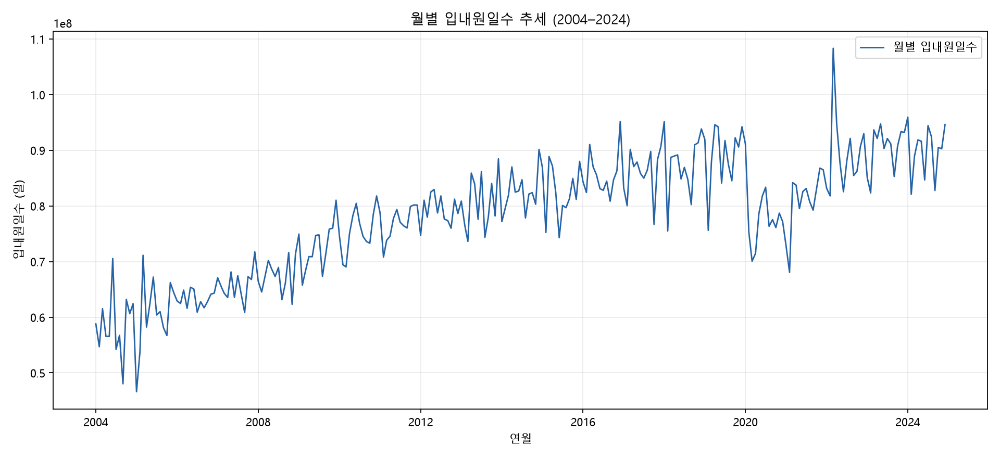
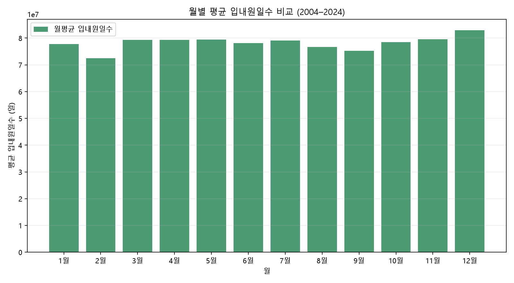
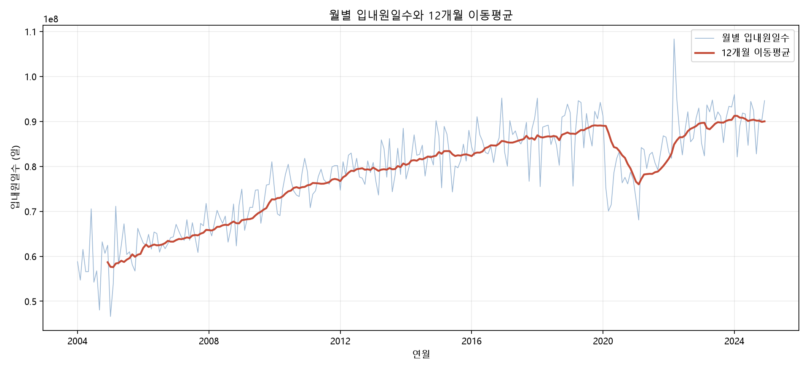

# 병원 이용 데이터 기반 월별 의료 트렌드 분석

## 1. 프로젝트 주제 및 선정 이유

이 프로젝트는 국민건강보험공단의 월별 건강보험 진료 자료를 이용해 2004년부터 2024년까지 병원 이용량의 장기적인 변화를 살펴본다. 월별 자료를 사용하면 오랜 기간에 걸친 추세뿐 아니라 월별 차이와 급격한 변동 시점도 함께 확인할 수 있다. 이에 따라 병원 이용량을 실제 진료 자료에 근거해 분석하는 주제로 선정했다.

## 2. 분석 목적 및 연구 질문

분석 목적은 월별 입내원일수의 장기 추세와 반복되는 월별 차이를 확인하고, 진료비 변화도 보조적으로 살펴보는 것이다.

- 병원 이용량은 장기적으로 어떻게 변화했는가?
- 월별 병원 이용량에 차이가 있는가?
- 급격한 증가 또는 감소가 발생한 시기는 언제인가?

## 3. 데이터 출처 및 수집 기간

- **출처:** [KOSIS 국가통계포털](https://kosis.kr/)
- **통계표:** 국민건강보험공단 「월별 진료형태별 진료현황(총계)」
- **통계표 코드:** `TX_35001_A040`
- **분석 기간:** 2004년 1월~2024년 12월
- **원본 파일:** `data/hospital_data_original.csv`

## 4. 데이터 설명

| 구분 | 내용 |
|---|---|
| 원본 CSV 구조 | 55행 × 126열. 첫 두 행은 연도와 지표명으로 된 다중 헤더 |
| 분석 데이터 구조 | 252행 × 5열 |
| 분석 데이터 열 | `date`, `year`, `month`, `inpatient_outpatient_days`, `medical_expenses` |
| 핵심 변수 | 입내원일수, 단위 일 |
| 보조 변수 | 진료비, 단위 천원 |

원본은 연도가 열에 반복되고 지표가 그 아래 열 이름으로 배치된 가로형 구조다. 월은 행에 있으며, 월별 자료에는 의료기관 소계·입원·외래·약국 소계 분류가 있다. 분석에는 **의료기관 / 소계** 행만 사용했다.

## 5. 데이터 전처리

1. 원본 CSV를 CP949 인코딩으로 읽었다.
2. 첫 번째 헤더 행에서 연도, 두 번째 헤더 행에서 지표명을 확인했다.
3. 월 구분이 1월~12월이고 진료형태 구분이 `의료기관 / 소계`인 행을 선택했다.
4. 연간 합계를 나타내는 `계` 행은 제외했다.
5. 입내원일수와 진료비를 연도별 열에서 추출해 `date`, `year`, `month`가 있는 세로형 데이터로 정리했다.
6. 2004년 1월부터 2024년 12월까지 252개월을 날짜순으로 배치했다.
7. 두 분석 변수의 결측값은 각각 0개였고, 날짜 중복은 없었다. 결측값을 임의로 채우지 않았다.

분석용 CSV는 `data/hospital_monthly.csv`다. 원본의 2개 헤더 행과 연간 집계 행은 월별 시계열 분석에 포함하지 않았다.

## 6. 분석 방법

- **연도별 집계:** 입내원일수의 연도별 평균과 합계를 계산했다.
- **월별 비교:** 2004~2024년의 같은 달을 모아 1월~12월 월평균 입내원일수를 계산했다.
- **이동평균:** 입내원일수의 12개월 이동평균을 계산해 월별 변동을 완화한 장기 흐름을 살폈다. 252개월 가운데 초기 11개월은 12개월 창이 채워지지 않아 유효 이동평균은 241개다.
- **전년 동월 증감률:** 각 월을 12개월 전과 비교했다. 계산 가능한 값은 240개다.
- **진료비 변화:** 진료비의 연도별 합계를 비교했다. 진료비는 명목 금액이며 물가상승률을 반영하지 않았다.

## 7. 시각화 결과

### 7.1 월별 입내원일수 추세

파일: `images/01_patient_trend.png`

2004~2024년의 월별 입내원일수를 표시한다. 장기적으로 증가하는 흐름과 월별 변동이 함께 보이며, 2020년 전후에는 이전 추세와 다른 하락 구간이 관찰된다. 그래프만으로 하락 원인을 특정할 수는 없다.

### 7.2 월별 평균 입내원일수 비교

파일: `images/02_monthly_comparison.png`

각 달의 입내원일수 평균을 비교한다. 분석 기간의 평균은 12월이 가장 높고 2월이 가장 낮았다. 이 값은 월별 총 일수 차이를 보정한 일평균이 아니므로, 계절 효과만으로 해석해서는 안 된다.

### 7.3 월별 입내원일수와 12개월 이동평균

파일: `images/03_moving_average.png`

월별 실제 값과 12개월 이동평균을 함께 나타낸다. 이동평균은 단기 변동을 완화하며, 장기 상승 흐름과 2020년 무렵의 하락 및 이후 회복 흐름을 보기 쉽게 한다.

## 8. 주요 분석 결과 및 인사이트

### 8.1 데이터에서 직접 확인한 사실(Fact)

1. 의료기관 소계의 연간 입내원일수 합계는 2004년 **704,120,946일**, 2024년 **1,080,241,721일**이다. 2004년 대비 2024년에 **53.42% 증가**했다.
2. 월평균 입내원일수는 12월 **82,909,253일**, 2월 **72,510,144일**로, 분석한 달 중 12월이 가장 높고 2월이 가장 낮았다.
3. 전년 동월 증감률에서 가장 큰 감소는 **2020년 4월 -24.46%**, 가장 큰 증가는 **2006년 1월 +35.00%**였다.
4. 연간 진료비 합계는 2004년 대비 2024년에 **465.15% 증가**했다. 이는 물가를 보정하지 않은 명목 금액의 변화다.

### 8.2 가능한 해석 또는 가설(Hypothesis)

- 21년 전체로 입내원일수 합계가 늘어난 사실은 장기적으로 건강보험 의료기관 이용 규모가 커졌을 가능성과 부합한다. 다만 이 분석만으로 인구 구성이나 의료 이용 행태 중 어느 요인이 영향을 주었는지는 알 수 없다.
- 12월과 2월의 평균 차이는 계절적 이용 패턴과 관련될 수 있다. 그러나 월별 일수 차이, 공휴일, 진료일 수 등의 영향도 함께 있을 수 있어 계절성으로 단정할 수 없다.
- 2020년 4월의 큰 전년 동월 감소는 특정 시기의 외부 변화와 관련되었을 가능성이 있지만, 이 자료만으로 원인을 확인할 수 없다.
- 진료비 증가율이 입내원일수 증가율보다 큰 것은 진료비 단가 또는 진료 구성의 변화와 관련될 수 있다. 명목 금액의 비교이므로 물가 변화를 분리해서 해석해야 한다.

### 8.3 추가 검증이 필요한 부분

- 물가 지수로 진료비를 보정해 실질 금액 기준 변화를 비교해야 한다.
- 월별 일수 및 실제 진료일 수 차이를 보정한 뒤 계절 패턴을 재검토할 필요가 있다.
- 인구 규모·연령 구조, 의료기관 수, 진료 형태별 자료와 함께 분석하면 이용량 변화 요인을 더 구체적으로 살펴볼 수 있다.
- 급격한 증감 시점은 별도의 공식 자료나 사건 기록과 대조해야 원인에 관한 가설을 검증할 수 있다.

## 9. 결론 및 한계

2004~2024년 의료기관 소계의 월별 입내원일수 자료에서는 전체적으로 증가하는 장기 흐름이 확인됐다. 월별 평균과 전년 동월 증감률에서는 달에 따른 차이와 큰 변동 시점도 관찰됐다. 진료비도 크게 늘었지만, 명목 금액이므로 물가상승률을 반영한 실질 증가로 해석할 수 없다.

이 분석은 건강보험공단의 해당 통계표 중 의료기관 소계에 한정된다. 월별 입내원일수 합계는 월별 일수 차이를 보정하지 않았고, 월별 변화의 원인을 설명하는 외부 변수도 포함하지 않았다. 따라서 결과는 관찰된 추세와 차이를 설명하며, 원인이나 인과관계를 입증하지 않는다.

## 10. AI 활용 기록

| 사용 작업 | 사용 이유 | 검증 방법 |
|---|---|---|
| 데이터 구조 파악 지원 | 다중 헤더, 연도별 지표 열, 월별 분류를 해석하기 위해 사용 | 원본 CSV를 CP949로 직접 읽고 행·열, 헤더, 분류값과 기간을 확인 |
| 전처리 코드 작성 지원 | 의료기관 소계의 월별 값만 세로형 데이터로 정리하기 위해 사용 | 원본 표본과 변환 결과를 비교하고 252개월, 날짜 정렬, 중복·결측 여부 확인 |
| 분석 및 시각화 코드 작성 지원 | 연도별·월별 집계, 이동평균, 전년 동월 증감률 및 그래프 생성을 위해 사용 | 스크립트를 실제 분석 CSV에 실행하고 계산 개수와 그래프 파일을 확인 |
| 결과 검증 및 보고서 작성 지원 | 분석 결과를 읽기 쉽게 정리하고 관찰과 가설을 구분하기 위해 사용 | 콘솔 출력 수치와 그래프를 확인하고 보고서의 주요 수치를 실제 계산 결과와 대조 |

AI는 코드와 설명 작성에 도움을 주었으며, 보고서의 수치와 해석은 실제 KOSIS CSV 및 분석 결과를 기준으로 검토했다.
